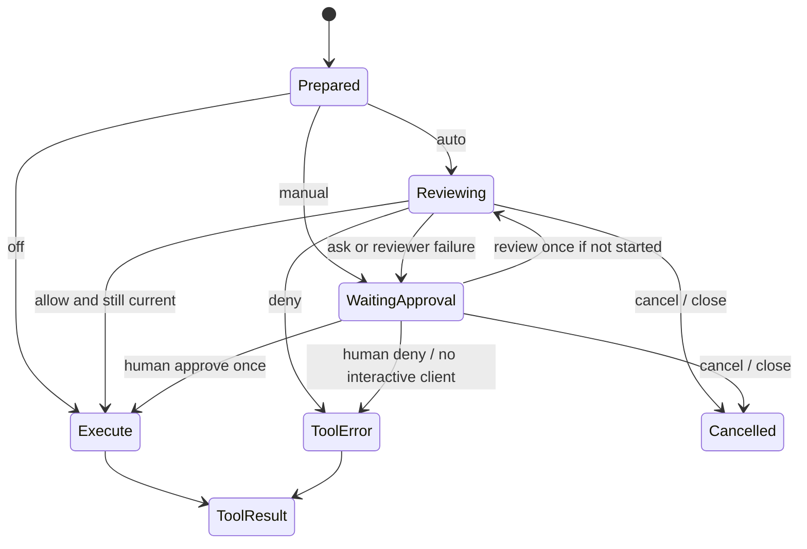

# RFC: Quick command approval / 帮我批准

> Status: Proposed; documentation only, no runtime behavior changes.
> Date: 2026-10-13. Baseline: `d75898e31e3140beca2fc5477adf11e951112719`.
> 本文的 MUST / MUST NOT 是拟实现的约束，不表示当前版本已支持。

## 1. Summary

给 e-agent 的本地 shell 工具增加可选的快速审批：人工模式提供“批准一次 / 拒绝”，
自动模式让一个无工具的独立模型调用先审阅命令，仅在明确允许后执行；不确定或审阅失败交给用户。
Web、TUI、REPL、one-shot 和子 agent 共用现有 `SessionRunner` 路径。

典型场景：用户要求修复项目并运行测试。`cargo test` 命令进入审阅，审阅器结合用户请求、
工作目录、真实 shell 和 sandbox 配置返回允许，命令随即执行；模型提出把本地文件上传到
陌生主机时，审阅器拒绝并把简短原因返回执行模型。用户不必逐个确认常规命令，也能看到决策依据。
例子说明期望行为，不构成静态命令白名单，也不保证测试脚本没有副作用。

只增加一个具体 command-review helper 和 runner 等待分支。没有 `PermissionProvider` trait、
reviewer agent 生命周期、后台审阅池或权限规则 DSL。复用现有 `Model`、session store、
`SessionHandle` 命令通道及事件 fanout。

## 2. Codex investigation: facts and limits

### 2.1 产品语义

官方文档说明：`Approve for me` 保留 sandbox，使用独立审阅器处理原本需要审批的请求；
配置是可交互的 approval policy 加 `approvals_reviewer = "auto_review"`。
审阅器看到精简对话和精确动作，拒绝后执行 agent 应寻找实质更安全的方案或询问用户。
它不是所有命令的必经检查，也不是确定性的安全保证。
来源：[Sandbox](https://learn.chatgpt.com/docs/sandboxing)、
[Auto-review](https://learn.chatgpt.com/docs/sandboxing/auto-review)。

### 2.2 本机发布包观察

分析对象是 Windows `OpenAI.Codex_26.1007.2314.0_x64` 的 `app.asar`，仅静态读取，
没有执行提取的 JavaScript，也没有修改安装包或用户权限。
ASAR SHA-256：`c5fdef328cfa2ad9095786f9c3a7aaa447e68834d31299d6ef2592da02029038`。

| Evidence | 观察 | 可以支持的结论 |
|---|---|---|
| L1 | `webview/assets/zh-CN-b05cfd55c534.js` 的 `composer.permissionsDropdown.guardianApproval.*` 和 `approvalRequest.autoReviewNudge.enable` 均为“帮我批准” | 中文入口确实对应自动审阅；另有“允许一次”的独立 key |
| L2 | `permissions-mode-dropdown-7bfb50f8e130.js` 把入口绑定到 `guardian-approvals`，有能力/requirements 检查，点击调用 `He("guardian-approvals")` 一类状态 setter | 入口选择审批模式，不是直接对任意命令返回 allow |
| L3 | `.vite/build/src-CP7XXlpZ.js` 的 `Bn`、`Yn`、`$n`、`Rn` | 默认 guardian preset 是 `:workspace` / `workspace-write` / `on-request`；包内使用 `guardian_subagent` 并识别 `auto_review`；`$n` 也能保留已有 read-only 配置 |
| L4 | `auto-review-approval-nudge-448eba57723e.js` 启用回调携带 conversation/host 与 mode setters，有失败提示，并说明可能增加额度消耗 | 减少审批提示的推荐入口是在启用模式；完整持久化链路未在本次范围内验证 |
| R1 | REA 6.4.0 对三个选定模块的静态图分析 | 记录模块、导入、语法关系和范围限制；未收录的大 bundle 导入保持 unresolved |

R1 Evidence ID：`ev_754b7838b60749c989ef4fdaddb9e639d6bca11c0f55c98ce8af354c0309005c`。
选定目录 digest：`0469c8c96102b7ff747b6473e426deeebf867b0badffd3748b8d414ef2ee6a1f`。
R1 的三个文件是 dropdown、nudge 和 `bundle-f75e49e28eab.js`（requirements 解析）。
L1/L3 是独立的本地脚本检查，不伪称 REA 输出。

复核用模块 SHA-256：

```text
permissions-mode-dropdown-7bfb50f8e130.js
6fc4519756720d0ef951d99c6b26dbfc5c4a2ea63c3f9f2a5313d5754020f5d7
.vite/build/src-CP7XXlpZ.js
79623d50989f9efbcb8e5752c56b3cc608a0f5993c05112e03e11b718ac7a586
zh-CN-b05cfd55c534.js
b4c388322e812e4b9a2fef48bbe3087ade074a0040533484867e603796b90fdb
```

REA skill 来自 [morluto/rea](https://github.com/morluto/rea/tree/main/.agents/skills/reverse-engineer-anything)，
本次为 skill metadata v41、CLI 6.4.0。skill 安装与 MCP 注册不同；本次通过 CLI 分析，未声称 MCP 已连接。
不把发布包完整复制进仓库。上述哈希用于身份复核，不证明运行时行为。

### 2.3 官方开源代码交叉检查

另行检查 `openai/codex` commit `12cca49c81c8aa6a37a5cc4e39964ee3b70f9458`：

- [routing.rs](https://github.com/openai/codex/blob/12cca49c81c8aa6a37a5cc4e39964ee3b70f9458/codex-rs/ext/guardian-reviewer/src/routing.rs)：`routes_approval_policy_to_guardian` 检查 policy 与 reviewer；具体路由还存在扩展贡献者、同步审阅和 action validation。
- [decision.rs](https://github.com/openai/codex/blob/12cca49c81c8aa6a37a5cc4e39964ee3b70f9458/codex-rs/core/src/guardian/decision.rs)：捕获精确请求，读取托管约束，传播取消；扩展返回后仍检查取消。`None` 表示回到用户流程，不等于允许。
- [prompt.rs](https://github.com/openai/codex/blob/12cca49c81c8aa6a37a5cc4e39964ee3b70f9458/codex-rs/core/src/guardian/prompt.rs)：精简 transcript 与 exact action 是分开的输入，固定策略放在 reviewer developer message。
- [circuit_breaker.rs](https://github.com/openai/codex/blob/12cca49c81c8aa6a37a5cc4e39964ee3b70f9458/codex-rs/ext/guardian-reviewer/src/circuit_breaker.rs)：标准策略连续 3 次或最近 50 次内 10 次拒绝会中断；cyber specialty 分支阈值不同，不能把 3/10/50 说成所有模型的固定值。

这份公开源码比本机发布包具有不同版本身份。它支持设计对照，不证明本机使用完全相同的后端。
本次没有测量真实审批延迟、误放行率、生产 reviewer 型号、服务端 policy 或运行时请求。

## 3. e-agent fit and non-goals

当前 shell 默认不受 sandbox 限制；审批缺席并不等于默认有 Codex 的 workspace sandbox。
Windows restricted-token MVP 也只有有限写限制，不能宣称读/网络隔离。
见 [Safety boundaries](../README.md#safety-boundaries) 与 [Windows sandbox spec](../WINDOWS_SANDBOX_SPEC.md)。

本提案明确选择：**启用时审阅每次已注册的本地 shell 调用**。e-agent 尚无 Codex 那样完整的
“仅越过边界才审批”协议，V1 不增加该协议。批准只允许按既有 sandbox 执行一次；
失败后 MUST NOT 自动关闭 sandbox、修改 writable roots 或重试裸 shell。

Non-goals：

- 不是通用权限框架、OS sandbox、恶意 agent 的完整隔离或安全认证。
- 不覆盖 file tools、`run_rust`、MCP、web tools 或它们间接产生的执行；UI 必须称“命令审批”，不能称“所有操作保护”。
- 不实现前缀/通配符白名单、永久授权、相似命令缓存、自动规则学习、跨会话授权或组织策略系统。
- 不增加新 crate、trait、scheduler、并行执行器、agent messaging 或多轮 reviewer。
- 不复制 Codex 的 Guardian 扩展体系、模型特例或服务端策略；不承诺恢复崩溃前尚未执行的审批。
- 本 PR 不实现功能。README 的 permission-framework non-goal 保留并补充本提案的边界。

## 4. Configuration and user experience

新增以下**拟议**用户级配置，沿用现有 model profile，不自动选型号：

```toml
[command_review]
mode = "manual"            # off (default) | manual | auto
profile = "reviewer"       # existing model profile; required for auto/review-once
timeout_secs = 15          # reviewer request deadline, not shell timeout
```

`off` 保留当前行为，不能在 UI 上标成“安全”。`manual` 每次等待用户。
`auto` 为每次命令调用一次 reviewer；`allow` 才执行，`ask` 等待，`deny` 返回工具错误。
15 秒是初始提案值，未进行性能测量。profile 不存在时启动/切换失败；不得退回 off。

配置只从用户级文件读取，启动时固定。项目 TOML 中出现该节必须明确拒绝；仓库文件、
AGENTS.md、工具输出、普通聊天文本不得改变模式或审阅 profile。
这不是对能任意改写用户配置的恶意执行者的隔离保证。

拟议 `/approval off|manual|auto` 是前端识别的结构化用户命令，经 `SessionHandle` 修改当前会话。
开启 auto 必须显示 reviewer profile 和可能额外消耗 token；不单独弹第二次确认。
模式切换只影响之后发起的请求，不能隐式批准正在等待的命令。既有子会话保持各自快照，
新创建的子会话继承父级当前模式；会话内修改重启失效，再读取用户配置。

人工卡片显示：完整 command（长文本可展开）、workspace、真实 shell、前台/后台/常驻标记、
sandbox 是否开启及实际限制、当前请求所属 session，以及短 reason。
三个操作是“批准一次”“拒绝”“审阅这次”。“帮我批准”放在模式选择中，表示后续自动审阅，
避免把一次动作与会话模式混为一谈。人工批准不产生隐含的未来授权。

Web/TUI/REPL 对同一请求显示同一状态；one-shot/无交互执行若得到 ask，立即返回
`command approval requires an interactive client` 工具错误，不无限等待，也不自动 allow。
Web 浏览器断线不算拒绝：live `WaitForInput` session 保留 pending，重连可处理；用户仍可 cancel。

## 5. Minimal implementation and exact request binding

现有入口定位以 baseline 为准；实现时按符号搜索，不依赖行号恒定：

| Existing location | Proposed change |
|---|---|
| `src/config.rs` (`BashConfig` nearby), `src/session_factory.rs` | 一个具体 `CommandReviewConfig`，用户级解析/验证；建造时将 reviewer Model 和配置传给 runner |
| `src/runner.rs` (`SessionCommand`, `SessionStatus`, `await_tool`, tool-call loop) | 一个审批等待分支，在 `await_tool` 前完成审批；根/子会话相同 contract |
| `src/tools/bash.rs` (`Bash`, `Shell::detect`, `Tool::execute`) | 共享纯参数解析/准备结果，捕获实际 shell 信息；前台、后台、detached 都必须在注册任务或 spawn 前审批 |
| `src/agent.rs` (`execute_tool`, `execute_on`, `Agent::run`) | 以注册时记录的 builtin shell 身份识别命令，不能仅比较字符串 `bash`；明确 legacy direct-run 边界 |
| `src/server.rs`, `src/ui/render.js`, `src/tui.rs`, REPL | 使用已有认证、SSE 与 handle 通道，显示 pending 并提交结构化答复 |
| `src/session.rs` / session entry projection and store codecs | 一个 additive 审阅摘要记录，通过既有 single-writer commit/apply/emit 流转；不建立第二条日志管线 |

Windows 的对外工具名是 `pwsh`，包括 Git Bash fallback；必须记录实际 executable/args，
不能由工具名推断 shell 语法。read-only role 若没有注册 shell，审批不能重新赋予工具。

runner 持有一个不可变的 prepared request：

```text
session_id + turn generation + call_id + random request_id
exact command UTF-8, canonical workspace, selected shell executable + args
background, detached, title, effective timeout, effective sandbox snapshot
```

只用一个具体 prepared-call struct，复用 shell 解析函数，不新增 Tool trait 方法或通用 middleware。
执行必须消费同一份已解析参数和 shell 选择；不得在批准后重新检测 shell/切换 workspace。
如果当前 Tool 接口限制实现，应使用具体 helper 在现有 dispatch 处传入批准的 prepared call，
而非复制一套解析规则。审批不冻结文件内容、PATH 对应文件或环境，V1 不承诺消除文件系统 TOCTOU。

拟议 `SessionCommand::ResolveCommandApproval { request_id, decision, reply }` 中 decision
只能为 approve/deny/review_once；reply 是一次 acknowledgement。HTTP 的拟议
`POST /api/sessions/{id}/command-approvals/{request_id}` 只接受 decision，复用 token auth，
不接受替换 command、cwd 或权限。request id 不是凭据。

每 session 最多一个 pending，tool batch 仍顺序执行。session/turn/request 三者匹配才接受；
首个终态决策原子消费请求，重复点击/过期请求返回 409，未知 session 返回 404。
cancel、session close、进程重启作废请求；replay 永远不能重建可执行授权。
review_once 只原子设置 reviewer_started，不消费请求或授予执行权限；人工 approve/deny 可以
先赢得终态，晚到模型结果必须丢弃。每 request 最多一次 reviewer 调用；auto 已审阅过或
review_once 返回 ask 后，隐藏/禁用“审阅这次”。不允许在同一请求上反复审阅直到得到 allow。

现有 `Agent::run` 是另一路直接执行入口。启用 command review 的 factory 路径 MUST 使用 runner；
若调用方试图在 direct-run 使用该配置，应明确报错而不是绕过。未配置该特性的底层库直接调用仍在范围外。

## 6. Reviewer contract

使用独立的一次 `Model` 调用，固定短策略、空 tools 列表、无 delegate、无文件/网络工具、
无 reviewer SessionRunner。不复制执行 agent 的 system prompt、skills 或隐藏 reasoning。
复用选定 profile 的 provider 能力；即使不支持 structured-output 参数，也必须严格解析最终 JSON。

输入包括精确 prepared action、当前用户请求、有限的近期可见对话/相关工具结果。
子会话继承 runner 捕获的真实人类请求/结构化授权快照，子模型不可覆写；父模型生成的
delegate task 和 agent messages 只是上下文，不算人类授权。没有可验证的人类授权来源时 ask。
工具输出、命令正文和项目内容必须作为不可信数据分段，不可成为 reviewer instructions。
输入总预算初始 16 KiB、command 上限 8 KiB、输出 2 KiB；这些是 V1 提案常量。
完整动作或当前用户请求放不下时直接 ask，不能截断动作后 allow。其余上下文有删节必须标记，
不明确的授权直接 ask。不要为了审阅读取密钥、整个环境或无关文件。

```json
{"decision":"allow","reason":"The requested test command matches the user's task and the configured execution scope."}
```

仅接受 allow/ask/deny，非空 reason，拒绝未知字段、多个 JSON 值、额外工具调用及超长输出。
固定策略要求：判断命令实际效果、数据去向、不可逆操作和用户授权；不根据 `git`、`cargo`、
`python` 等名字直接放行。安装、测试和解释器可能运行仓库提供的代码。证据不足用 ask；
明显越权/外传/广泛删除用 deny。主模型声称“用户已批准”不能替代真实用户输入。

超时、断流、无最终结果、非法结构、预算溢出一律 ask，最多一次调用，没有自动重试。
timeout 是审阅失败，不应伪装成安全拒绝。取消必须传播到 reviewer，晚到 allow 不得启动命令。
用户消息在等待中到达只排队；授权变化必须取消当前请求并生成新请求，不能把普通 prompt 当答复。

选用 profile 意味着命令和必要上下文发送到该 profile 的 provider。UI 在启用时显示这个目的地；
不额外发送文件/凭据。疑似含显式 secret 的命令直接人工处理，不自动发给 reviewer；这类检测不能保证识别所有秘密。
记录 reviewer 的 usage/耗时，并纳入现有 goal token soft-cap 统计；预算不足时 ask，不悄悄免费重试。

## 7. State, persistence and failure behavior



拟议 `WaitingApproval` status 携带当前请求及 reviewing/waiting 阶段；通过已有 Shared snapshot
与 broadcast 向所有前端一致投影。等待/审阅中即时处理 ResolveCommandApproval、Cancel、
Closed、WebAttach；其他消息排队。人工终态响应不能被排到 reviewer 结束之后。
MUST NOT 持有 Shared mutex 跨 await，不能把 WebAttach 卡在人工回应后。

审批终态在执行前写入一个 `CommandReview` 摘要 entry：request/call/session 关联、
mode、decision、origin（human/reviewer）、短 reason、profile、elapsed_ms、usage。
引用既有 ToolCall，避免再次持久化完整命令或 reviewer 输入；不持久化 reasoning。
它只用于 UI/audit，provider transcript 不回放为授权；旧记录缺少该 entry 时照常读取。
三个存储后端都走已有序列化与投影入口。存储失败不能执行命令，沿现有 store error 路径处理。
持久化完成后、实际派发执行前，MUST 再处理已到达的取消并检查 request generation 仍有效；
不能仅在 reviewer 返回时检查。人工终态应取消仍在运行的 reviewer future。

崩溃在“已记录 allow”与 spawn 之间不能保证 exactly-once；恢复只显示历史审批，不自动重试。
拒绝写成原 call_id 的普通错误 ToolResult，让执行模型继续处理；同批剩余调用维持配对。
取消沿现有 release / repair_tool_pairs 语义，不把 session 结束，也不取消无关后台任务。

同一 turn 精确相同 prepared action 的拒绝不再次送 reviewer，直接返回原拒绝原因。
连续三次拒绝后，本 turn 余下 shell 调用返回“需要用户处理”，禁止 goal continuation 自动重启
这一审批循环，直到新的人类任务或专用恢复操作；attach、模型/审批模式切换、后台完成、
子 agent 消息及 goal continuation 均不复位。既有后台任务继续。
这是 e-agent 的简化设计，不复制 Codex 的窗口算法。
执行模型必须收到“不得改写为等价间接命令来绕过”的短说明；文字约束和精确匹配不构成语义防绕过保证。

## 8. Delivery slices and acceptance

1. **Manual gate first**：shared prepared call、runner 等待/取消、Web/TUI/REPL/one-shot、子会话、一次性答复和审计；默认 off。
2. **Review once + auto**：复用现有 profile 的单次无工具审阅、严格结果、失败回人工、usage 与重复拒绝限制。
3. **Validate UX**：检查前后台命令、子会话 attach、状态卡片与实际 provider 成本；再讨论是否改变默认值。本 RFC 不改变默认值。

实现 PR 必须通过仓库的 `cargo fmt --all`、`cargo clippy --all-targets -- -D warnings`、
`cargo test`、`cargo build`，并覆盖下面的行为测试；本 RFC 没有实现这些测试或声称功能已验证。

| Scenario | Required observation |
|---|---|
| off | 原有命令/错误/后台完成语义一致，零 reviewer 请求 |
| bash / pwsh / Windows Git Bash fallback | 相同 gate，UI shell 信息与真正 spawn 相同 |
| foreground / background / detached | 批准前无 spawn、无后台任务注册；批准只执行一次 |
| manual approve / deny / review_once | 精确绑定，拒绝为 ToolResult，不能提交替换命令 |
| allow / ask / deny / timeout / malformed / injected instructions | 只有有效且仍当前的 allow 执行；失败不得放行 |
| duplicate click / stale reply / two tabs / late model result | 单一终态；过期 409；无第二次执行 |
| cancel / close / restart / queued prompt / cancel during audit write | 包括 allow 后写日志期间的取消均无晚到执行；恢复不授予权限；普通文本不批准 |
| WebAttach / SSE reconnect / TUI attach | 同一 pending 快照，等待期间 attach 不阻塞 |
| subagent / fabricated parent authorization / sequential batch / direct-run | 子会话同 gate，不把父模型文本当人类授权，工具结果配对，不支持入口明确失败 |
| sandbox / read-only / project config | allow 不扩大权限，不添加缺失工具，项目不能覆盖审批配置 |
| store error / review cost / repeated denials | 审计失败不执行，usage 入预算，不自动循环请求 |

需要单独做的评估：代表性安全/危险/含糊命令集、误允许和误拒绝、P50/P95 审阅延迟、
人工提示减少量及 token 开销；预先标注期望结果，记录模型/profile 版本。没有测量前不承诺“毫秒审批”。

## 9. Alternatives and open decisions

- 直接自动点击 approve：没有独立审阅和精确动作绑定，放弃。
- 正则/前缀白名单：shell 组合、脚本内容及 Git hooks 使名字不足以证明效果，V1 不做。
- 完整 Guardian 移植：与 single-crate/no-framework 原则冲突；保留用户价值，不照搬框架。
- 只做 sandbox escalation：当前缺少统一边界请求，V1 先做 shell 调用前的审批。

建议接受的初始决策是 default off、用户级配置、会话级 auto、无工具 reviewer、人工一次授权、
shell-only 且不提权。实现前需要维护者确定：15 秒/16 KiB 预算是否合适、哪个既有 profile 用于评估，
以及已知不受控的 `run_rust`/MCP 场景是否需要另立后续提案。不能因此预建权限框架。
